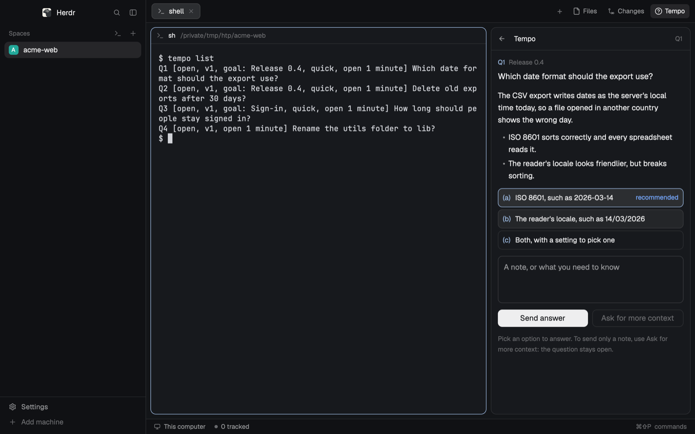

# Tempo

A panel in Herdr's side panel, beside Files and Changes, that lists the open questions
[Tempo](https://github.com/andrebras/tempo) holds for the project in the shown space. Tempo
keeps the questions Claude asks while it works. A click opens a question in the panel: its
context, its options with the recommended one marked, a note box, and its thread. The
person picks an option and sends the answer, or sends only a note to ask for more. A notice
says when a new question arrives, and the Tempo button in the tab bar shows the open count
while the panel is hidden.

## What you see

- **Sizes:** text follows the terminal font size (`settings().font_size`, 14 when unset).
  Below, `size(n)` means that size minus 1, plus `n`: the list is `size(0)`, labels
  `size(-1)`, question text `size(1)`, the question's title `size(2)`.
- **The panel:** fills Herdr's side panel. Radius 10, a 1px `border`, `background` fill,
  `foreground` text, clipped at its edges.
- **Header:** 42px high, 14px side padding, 8px gaps, a 1px `border` line under it. Left to
  right: a back arrow `←` (20px wide, `muted`) only while a question is open; "Tempo"
  (semibold); then, right-aligned in `dim` at `size(-1)`, the project's name, or `Q<n>`
  while a question is open.
- **List:** scrolls; 8px padding, 2px between rows.
  - **Goal headings:** the goal's name, `size(-1)`, `dim`, 6px above, cut when too long.
    Questions without a goal come last, with no heading.
  - **Rows:** 6x5px padding, radius 6, `hover` fill on hover. The label (`Q12`, at least
    34px, never wrapped) in `accent`, or `working` while Claude owes a reply to a
    follow-up; then the title, wrapped.
  - **Status line**, when there is nothing to list: one `size(-1)` `muted` line. "The tempo
    command wasn't found. Install it with /tempo:install.", the error text, "Reading…",
    "This space isn't on this computer." or "No open questions here."
- **A question:** scrolls; 12px padding, 12px gaps. Top to bottom:
  - The label in `accent` and the goal in `dim`, at `size(-1)`; the title below,
    `size(2)`, semibold.
  - While Claude owes a reply: "Waiting on Claude to answer your follow-up." in `working`
    on `raised`, radius 6.
  - The context, as Markdown at `size(1)`, selectable.
  - The options, 4px apart. Each is radius 8 with 8x6px padding and a 1px border:
    `(a)` in `accent`, the text, and "recommended" in `done` at `size(-1)` on the
    recommended one. The picked option has an `accent` border and `selected` fill; the
    others a `border` border and `surface` fill; `hover` fill on hover.
  - A note box: placeholder "A note, or what you need to know", 3 lines high, growing to
    10. Radius 8, a 1px `input` border, `background` fill, `size(1)`.
  - Two buttons side by side, each half the width, 32px high, radius 8, medium weight:
    "Send answer" (`solid` with `solid_foreground` when it can act, else `raised` with
    `dim`) and "Ask for more context" (a `border` border on `surface`; `foreground` text
    when it can act, else `dim`). While sending, the first reads "Sending…".
  - A `dim` hint at `size(-1)`: "Pick an option to answer. To send only a note, use Ask
    for more context: the question stays open."
  - **Thread**, when the question has entries: a "Thread" heading, then one `surface` block
    per entry (radius 6, 8x6px padding): "You" or "Claude" and the time (`YYYY-MM-DD
    HH:MM`) in `dim`, then the text as Markdown. An answer reads `answered (b): <note>`; a
    new version reads `reworded the question: <why>`.

## How it behaves

- **Which questions:** those of the project Tempo finds in the shown space's folder, which
  is the folder of the shown tab's focused terminal (or its first one), else the space's
  folder, else the home folder. A space on another machine has none.
- **Switching spaces:** the panel checks the shown space every 300ms. On a switch, a list
  seen before for that folder shows at once, then a fresh read replaces it. A question
  open for another project closes.
- **Reading:** `tempo list --json --all-projects` (in the home folder) and
  `tempo list --json` (in the shown folder) run together, at once when Tempo's database
  changes, and every 4 seconds otherwise (every 30 seconds while the window is hidden). A
  read asked for while one runs is done right after it; a read that ends after a newer
  one is dropped.
- **Clicks:** a row opens its question (`tempo show <n> --json --project 
`); `←` goes
  back to the list. A click on an option picks it, and a second click unpicks it.
- **Send answer** (only with an option picked): `tempo answer <n> <letter> --project 
`,
  with `--note=<note>` when the note isn't empty. Then a "Answered Q<n>" notice, and the
  project's next open question opens, or the list when none is left.
- **Ask for more context** (only with a note): `tempo reply <n> --project 
 -- <note>`.
  The note box empties and the question reloads, with "Waiting on Claude…" shown.
- **A failed send:** an error notice with Tempo's message; the question stays.
- **An open question** reloads when its version or waiting state changes, and closes when
  it is no longer open.
- **New questions:** each read compares the newest `created_at` with the one last
  announced. Up to three new ones get a notice, "Tempo: Q<n> in <project>" with the title,
  for 8 seconds. For the shown project, a click opens the question when the panel shows,
  or shows the panel when it is hidden. The first read only sets the mark.
- **Count:** the shown project's open count is shared as `tempo.badge`; Herdr shows it on
  the Tempo button while the panel is hidden.
- **Agent status:** the panel shows none of its own. A question where Claude owes a reply
  has its label in `working`.
- **Palette:** "Show or hide Tempo" toggles the panel. "Show the next open question" sends
  `tempo.open`, which opens the project's first question, or shows "No open questions."
- **Never:** edits or deletes a question, opens Tempo's database itself, or touches the
  network.

## Built from

- **Mod:** `mods/tempo/` with `main.js`, `icon.svg` (the button's icon) and `mod.json`:
  `place: "none"`, title "Tempo", `panel: {title: "Tempo", icon: "icon.svg"}`, and two
  palette entries in group "Tempo": "Show or hide Tempo" (`layout.toggle {id: "panel",
  stack: "panel-body", child: "panel-tempo"}`, words `questions sidebar panel`) and "Show
  the next open question" (`tempo.open`, words `questions`).
- **Libraries:** `View` and `div` from `gpui-kit`; `h_flex`, `v_flex`, `Textarea`,
  `TextareaState` and `TextView` (Markdown, with `raw_html(false)`) from `gpui-base`.
- **Herdr functions:** `spaces`, `panes`, `layout`, `theme`, `settings`, `window`, `home`,
  `exec`, `watchFolder`, `notify`, `shared`, `setShared`, `nextCommand`, `checking`.
- **Commands:** `layout.select {stack: "panel-body", child: "panel-tempo", show: true}`
  from a notice; the mod's own `tempo.open` and `tempo.open:<n>:<project>`.
- **Programs:** `/bin/sh -c "command -v tempo"`, else `~/.local/bin/tempo` when
  `/bin/test -x` passes; `tempo list`, `show`, `answer` and `reply` as above, with a
  15-second limit on the reads; `/bin/test -e` to find the database.
- **Watched:** `~/.claude/tempo`, or `~/.claude/open-questions` (its name before a rename),
  whichever holds `questions.db`.
- **Shared values:** `tempo.announced` (the newest `created_at` announced) and
  `tempo.badge` (the count).
- **Tests:** `tests/` runs with `node --test`, without Herdr.

## Watch out

- **The `panel` key exists only in a fork of Herdr**
  ([andrebras/herdr-app](https://github.com/andrebras/herdr-app)). On the Herdr released at
  herdr.dev the panel does not appear.
- **"Show the next open question" does nothing while the panel is hidden:** Herdr delivers
  a mod's commands only to shown copies. Notices avoid this by showing the panel instead.
- **Thread times** are Tempo's UTC (Coordinated Universal Time) stamps with the `Z`
  dropped, not local time.
- **Notices** compare `created_at` at one-second precision, so a question made in the same
  second as the last one announced gets none. More than three new ones show only the last
  three.
- **Watch only** `questions.db` and `questions.db-wal`. Every read touches `-shm`, so
  watching it starts a read after every read.
- **Compare with `?? null`:** with no shown space, `undefined` and `null` must not count as
  a change, or each draw starts a read that draws again, without end.
- **Pass the note as one word** (`--note=<note>`) and the follow-up after `--`, so text that
  starts with a dash isn't read as an option.
- `tempo show --json` has no waiting state; take it from the list.
- A database set with `TEMPO_DB`, or a branch's own, isn't watched; the timer still reads
  it.
- Under `herdr-app check` (`checking()`), run no programs and start no timers.
- macOS and Linux only: it calls `/bin/sh` and `/bin/test`.

## Done when

- `herdr-app check mods/tempo` passes.
- The Tempo button shows and hides the panel beside Files and Changes.
- In a project with questions under two goals and one without, the panel lists them under
  two headings, the one without a goal last.
- Clicking a question shows its context, its options with "recommended" on the right one,
  the note box and the two buttons; "Send answer" stays dim until an option is picked.
- Picking an option and sending answers it in Tempo, shows "Answered Q<n>" and opens the
  next question.
- A note sent with "Ask for more context" appears in the thread, and the waiting line
  shows.
- `tempo add` in another terminal shows a notice within a few seconds, and the list gains
  the question.
- With the panel hidden, the Tempo button shows the open count, and it changes when a
  question is answered.
- With `tempo` missing from `PATH` and `~/.local/bin`, the panel says "The tempo command
  wasn't found."
